<p align="center">
  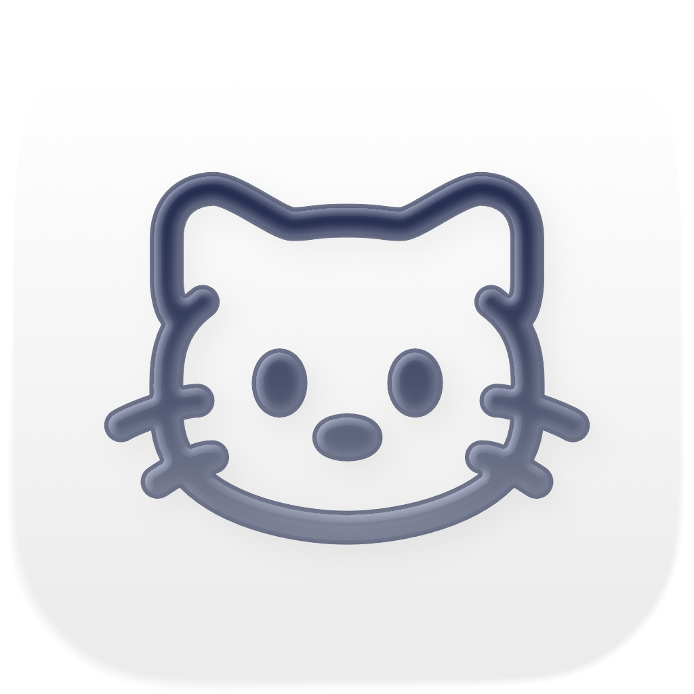
</p>

# ProxyCat

[mihomo](https://github.com/MetaCubeX/mihomo) 的原生 iOS 客户端。架构参考 [sing-box-for-apple](https://github.com/SagerNet/sing-box-for-apple)：SwiftUI 宿主 App 通过 `NEPacketTunnelProvider` 扩展承载网络隧道，扩展内嵌一份由 `gomobile` 生成的 mihomo XCFramework。

应用图标使用 Xcode 26 的 Icon Composer 格式（`AppIcon.icon/`），单一 SVG 源 + `icon.json` 描述图层、阴影、半透明，在打包时自动渲染出 iOS 26 Liquid Glass 所需的全部尺寸/外观（Default / Tinted / Dark / Clear）。

> [!NOTE]
> **TestFlight 公测即将开放 / TestFlight beta coming very soon** — 公开邀请链接将很快在此 README 发布，敬请关注本仓库。

## 功能

- **配置管理**：本地 YAML、订阅 URL、粘贴导入，导入/保存前用 mihomo 解析校验；支持分享、重命名与左滑编辑 MITM 子配置。
- **仪表盘**：连接状态、实时上下行、累计流量、扩展内存预算与活动连接数。
- **原生 Proxies / Connections**：代理组选择、延迟测试、连接列表与逐条关闭，全部走 App Group 私有 Unix socket。
- **日志**：等级过滤、搜索高亮、暂停/复制；按会话保存 mihomo 与 ProxyCat 日志，标记正在写入的 LIVE 文件并支持保留策略。
- **MITM**：每个 profile 独立的域名 / 端口 / ECH 策略 / 重写规则编辑器，配合本地根 CA 安装与信任检测。
- **网页配置**：在电脑浏览器中通过局域网编辑 profile YAML；需要访问令牌，仅在 App 前台运行。
- **自动化与统计**：Auto Connect（SSID / 蜂窝 / 默认动作）、7 / 14 / 30 天流量统计、iCloud 备份。
- **本地化**：English（源语言）、简体中文、日本語、Русский。
- **构建**：`python3 build.py` 统一管理 mihomo xcframework、xcodegen、资源下载、模拟器/真机构建与诊断。

## 截图

截图使用简体中文界面。

| Dashboard | Profiles | Statistics | Settings |
|:---:|:---:|:---:|:---:|
| 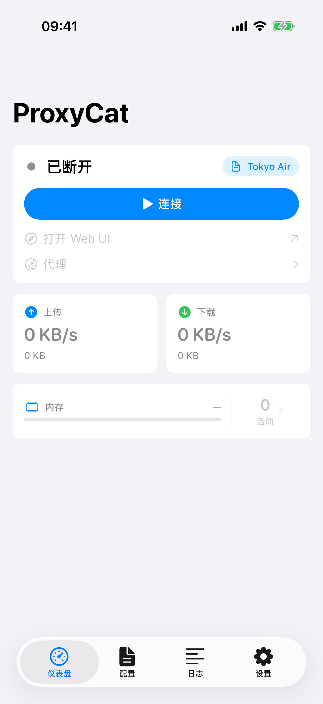 | 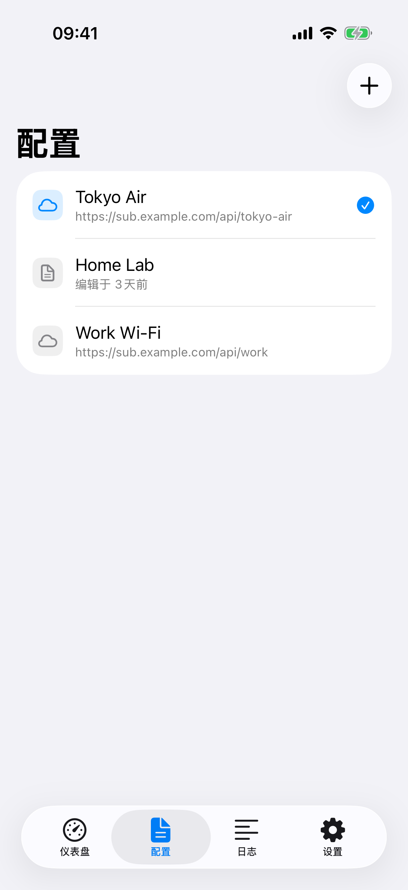 | 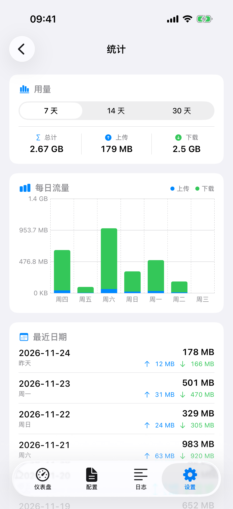 | 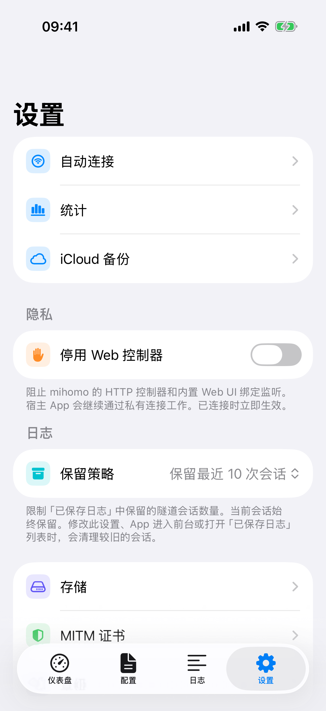 |
| 状态 / 流量 / 内存预算 / 活动连接 | 配置列表与 active 标记 | 7 / 14 / 30 天上下行统计 | 隐私 / 日志 / 存储 / MITM / 高级 |

| Profile Editor | MITM Config | Saved Logs | Auto Connect |
|:---:|:---:|:---:|:---:|
| 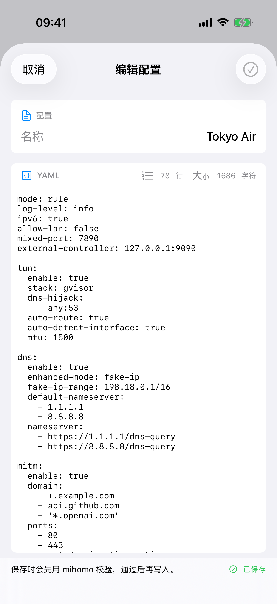 | 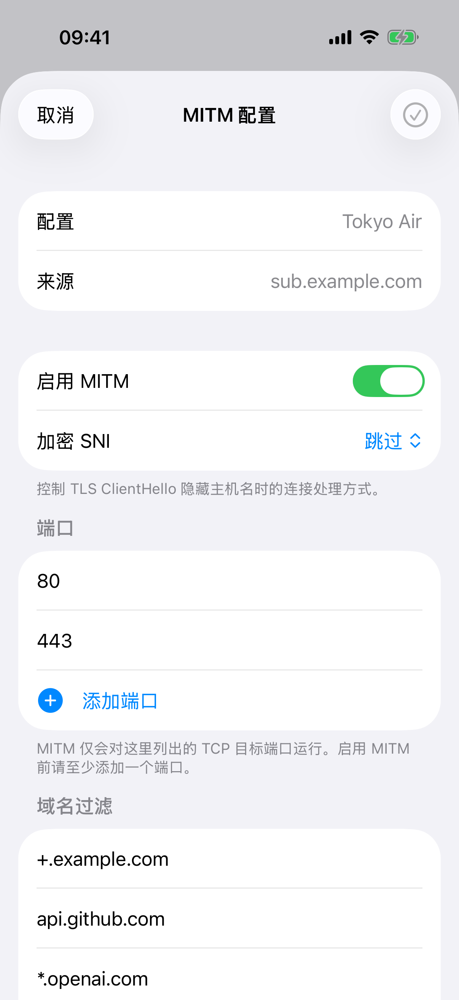 | 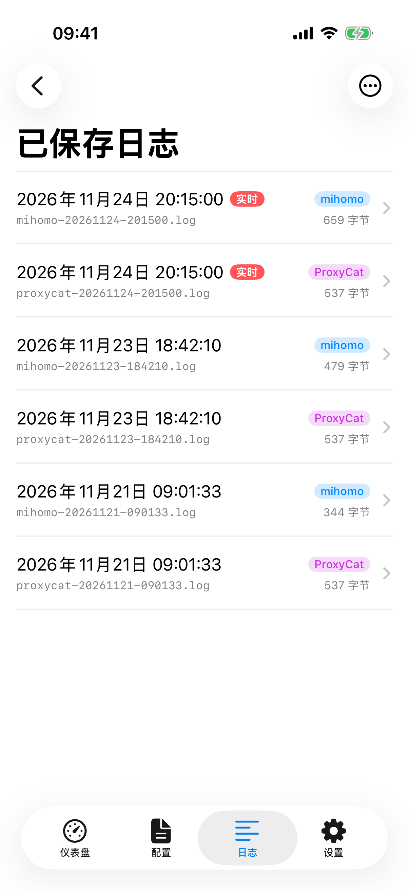 | 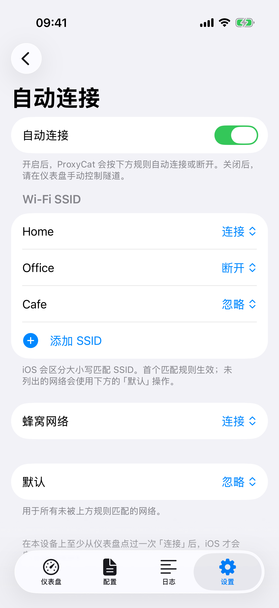 |
| YAML 编辑与 mihomo 校验 | 域名 / 端口 / 重写规则 | 会话日志 / 实时标记 / 保留策略 | SSID / 蜂窝 / 默认动作 |

| MITM Certificate | Diagnostics |
|:---:|:---:|
| 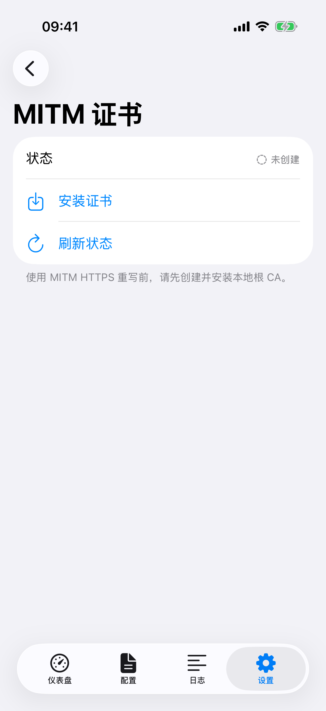 | 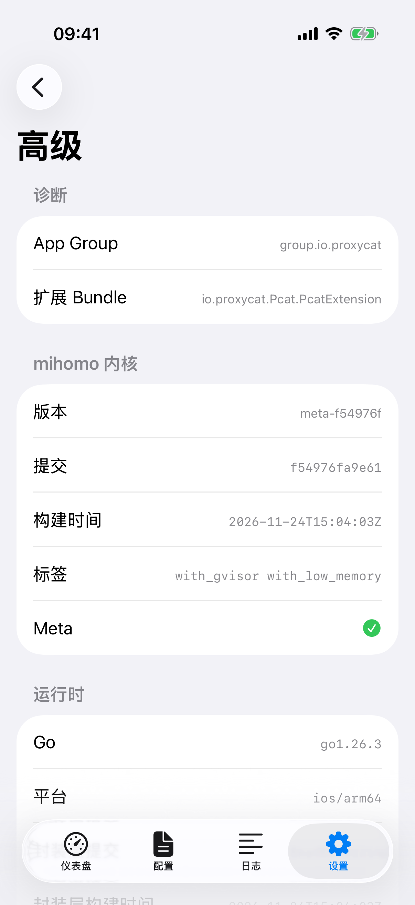 |
| 本地根证书安装与信任 | App Group / 内核版本 / 构建标识 |

## 本地化文案风格

ProxyCat 以英文为源语言，提供简体中文、日文与俄文翻译，并采用统一的产品文案风格：

- **语气**：简洁、中性、偏 iOS 系统设置风格；按钮和菜单使用短动词（如“保存”“取消”“重置”），提示语直接说明结果或前置条件。
- **术语**：`profile` 统一译为“配置”，`Dashboard` 统一译为“仪表盘”，`Statistics` 译为“统计”，`Saved Logs` 译为“已保存日志”，`Web UI` 保留英文写法。
- **日文术语**：`profile` 统一译为“プロファイル”，`Dashboard` 统一译为“ダッシュボード”，`Statistics` 译为“統計”，`Saved Logs` 译为“保存済みログ”，`Web UI` 保留英文写法。
- **俄文术语**：`profile` 统一译为「Профиль」，`Dashboard` 统一译为「Панель」，`Statistics` 译为「Статистика」，`Saved Logs` 译为「Сохранённые журналы」，`Web UI` 保留英文写法。
- **技术名词**：保留 `ProxyCat`、`mihomo`、`YAML`、`SSID`、`Wi-Fi`、`HTTP`、`URL`、`VPN`、`TUN`、`gRPC`、`App Group`、`GitHub`、`Go`、`iOS` 等原文。
- **标点**：中文句子使用全角标点（`，。？！；（）`），日文句子使用日文标点（`、。`），俄文句子使用半角标点并配合 «…» 引号；UI 名称引用使用中文 / 日文引号（`「…」`）或俄文 «…»；占位符（如 `%@`、`%lld`）和路径、命令、协议名保持原样。
- **一致性**：相同功能入口在不同页面使用同一译名；说明文字不混用“链接 / URL”“仪表板 / 仪表盘”“网页 UI / Web UI”等变体。

## 目录结构

```
proxycat/
├── libmihomo/              Go gomobile 包装层。对外暴露一个极简的 C 友好接口：
│   ├── binding.go          生命周期（Start / Reload / Stop）、路径配置、TUN fd 注入、Version
│   ├── settings.go         读取宿主写入的 runtime_settings.json（active profile + 运行时偏好的真源）
│   ├── command_server.go   扩展内的 gRPC 服务（Status + Logs 流，日志事件含 timestamp_ns）
│   ├── command_client.go   宿主侧 gRPC 客户端，回调通过 gomobile 抛回 Swift
│   ├── log_pump.go         单点 helper：订阅 mihomo log.Subscribe() 并把事件灌进给定 handler
│   ├── log_persist.go      把每次会话的日志写到 App Group 的滚动文件中（log_pump 的消费者）
│   ├── traffic.go          上下行 / 总流量 / 连接数快照
│   ├── oom.go              移植自 sing-box 的 OOM 守护，应对 NE jetsam
│   ├── proto/command/      gRPC 协议定义（Status / Log）
│   └── tools.go            固定 golang.org/x/mobile/bind 依赖（gobind 需要）
├── build.py                 Python 构建入口（替代原 Makefile + shell 脚本）
├── tools/proxycat_build/    构建实现：mihomo / xcodegen / assets / xcodebuild / doctor
├── tools/tests/             构建工具单元测试
├── BundledAssets/          编译期资源（geo DB / external UI / default-profile.yaml / web-editor）
├── Library/                共享 Swift framework：
│   ├── Models/             纯值类型（Profile / Connections / MitmProfileConfig /
│   │                       ICloudBackup / DailyUsage / AutoConnect / HostSettings /
│   │                       LogEntry / SavedLogFile / TrafficSnapshot）
│   ├── Stores/             可观察状态容器（ProfileStore / ProxiesStore /
│   │                       ConnectionsStore / RuntimeSettings / HostSettingsStore /
│   │                       DailyUsageStore / ICloudBackupStore / CommandClient）
│   ├── Services/           跨进程 / 系统能力（MihomoController / ControllerTransport /
│   │                       LibmihomoBridge / ExtensionProfile / ExtensionEnvironment /
│   │                       Coordinators（VPN 生命周期 / 设置 / Auto Connect / 流量）/
│   │                       RemoteProfileFetcher /
│   │                       ProxyCatLogger / ProxyCatLogPersistence /
│   │                       PersistentLogFile / BundledAssets / MemoryMonitor）
│   └── Support/            基础设施（AppConfiguration / FilePath / StorageMaintenance /
│                           JSONFileStore / ByteFormatter / ExponentialBackoff /
│                           Observed / AsyncOneShot / YAMLLine）
├── ApplicationLibrary/     SwiftUI 视图：
│   ├── App/                MainView（Tab 容器 + 环境注入）
│   ├── Dashboard/          Dashboard 及其卡片组件
│   ├── Profiles/           列表 / 编辑器 / 下载 / MITM 配置 / 分享
│   ├── Proxies/            代理组与节点
│   ├── Connections/        连接列表 / 详情
│   ├── Logs/               实时日志 / Saved Logs / 对应 ViewModel
│   ├── Statistics/         用量图表 / 数据整形
│   ├── Settings/           设置各子页
│   └── Components/         设计系统 / 共享弹窗 / YAML 编辑器 / 表单工具栏
├── Pcat/                   iOS App target（入口、Info.plist、entitlements）
├── PcatExtension/          Network Extension target（PacketTunnelProvider、
│                           NetworkPathMonitor、TunnelFileDescriptor）
├── AppIcon.icon/           Xcode 26 Icon Composer 资源（单一 SVG + icon.json 图层描述）
├── docs/                   ProxyCat 专属文档（MITM 证书与 YAML 配置等）
├── Tests/LibraryTests/     Swift Testing 套件 — ExponentialBackoff / RetryLoop / JSONFileStore /
│                           AutoConnect / DailyUsage / MemoryStats / TrafficSnapshot /
│                           ByteFormatter / LogEntry / Profile codable / MihomoController /
│                           WebConfig，运行: `xcodebuild test -scheme Library`
├── Tests/PcatUITests/      XCUITest — Web Editor 令牌隐藏与端口自动保存，
│                           运行: `xcodebuild test -scheme Pcat -destination '<simulator>'`
├── project.yml             XcodeGen 描述文件 — 用于（重新）生成 ProxyCat.xcodeproj
└── sample-profile.yaml     最小可用的 mihomo 配置示例
```

## 环境要求

- Python 3.10+（运行 `python3 build.py`，仅使用标准库；`app-icon` 子命令需要 Pillow）
- Xcode 26 / xcodegen
- Go + gomobile（构建 `Libmihomo.xcframework`）

```bash
brew install xcodegen
go install golang.org/x/mobile/cmd/gomobile@latest
go install golang.org/x/mobile/cmd/gobind@latest
gomobile init
```

运行 `python3 build.py doctor` 可以检查上述工具、mihomo submodule 与生成产物的状态。

mihomo 源码以 git submodule 形式 vendored 在 `proxycat/mihomo/`，跟踪上游 `Meta` 分支。`libmihomo/go.mod` 中的 `replace` 指向该子模块。

```bash
git clone --recurse-submodules <proxycat repo>
# 或者已经 clone 过：
python3 build.py mihomo-init    # 等价于 git submodule update --init --recursive mihomo
```

升级到最新 Meta tip 并重建 xcframework：

```bash
python3 build.py mihomo-upgrade  # checkout origin/Meta + 重建 xcframework
git add mihomo && git commit -m "Bump mihomo to <sha>"
```

或者钉到指定的 tag / commit / 分支（不跟踪 Meta tip）：

```bash
python3 build.py mihomo-checkout v1.19.5         # 锁定到一个稳定 tag
python3 build.py mihomo-checkout 35d5d4e44d7a    # 锁定到具体 commit
python3 build.py mihomo-checkout Meta            # 等效于 mihomo-upgrade（取 origin/Meta 当前 tip）
git add mihomo && git commit -m "Pin mihomo to <sha> (<ref>)"
```

`mihomo-upgrade` / `mihomo-checkout` 会先 `git fetch --tags origin`，再以 detached HEAD 方式 checkout 给定的 ref，最后调用 Python 构建器重建 xcframework。

`libmihomo/tools.go` 显式 import 了 `golang.org/x/mobile/bind`。没有这个文件 `gomobile bind` 会报错 `unable to import bind: no Go package in golang.org/x/mobile/bind`，因为 `go mod tidy` 会把没有源码引用的依赖剪掉，而 `gobind` 只在临时目录里 import 它。

## 首次构建

```bash
cd proxycat
export XCODE_DEVELOPMENT_TEAM=ABCDE12345  # your Apple Team ID
python3 build.py assets  # 下载 GeoIP / GeoSite / mmdb 与 metacubexd（仓库只跟踪 .gitkeep）
python3 build.py all     # 构建 xcframework + 生成 xcodeproj
open ProxyCat.xcodeproj
```

`python3 build.py project` / `python3 build.py all` 会从 `XCODE_DEVELOPMENT_TEAM` 自动填入 `DEVELOPMENT_TEAM`。未设置时生成的项目不会写入开发者团队；真机构建或 Archive 前需要设置该环境变量，或临时在 Xcode 中选择 Team。`python3 build.py sim` 会先重新生成项目并关闭签名；`python3 build.py build` 会先检查 `XCODE_DEVELOPMENT_TEAM`，再重新生成项目和执行真机构建。

常用命令：

| 命令 | 说明 |
|------|------|
| `python3 build.py libmihomo` | 仅重建 `Frameworks/Libmihomo.xcframework`；`--target sim` 只构建模拟器 slice |
| `python3 build.py libmihomo-obf` | 通过 garble 构建混淆版 xcframework |
| `python3 build.py project` | 运行 `xcodegen` 并自动注入版本号与 `XCODE_DEVELOPMENT_TEAM`（见下） |
| `python3 build.py version` | 打印下一次 `project` 会写入的版本/编号 |
| `python3 build.py all` | `mihomo-init` + `libmihomo` + `project`，首次 clone 后跑一次 |
| `python3 build.py all-obf` | `mihomo-init` + obfuscated `libmihomo` + `project`，用于提交前构建 |
| `python3 build.py mihomo-init` | 初始化或刷新 `mihomo/` submodule |
| `python3 build.py mihomo-upgrade` | 拉取最新 Meta tip 并重建 xcframework |
| `python3 build.py mihomo-checkout <ref>` | 钉到指定 tag / commit / 分支并重建 xcframework |
| `python3 build.py assets [geo\|ui]` | 下载 geo 资源与 metacubexd 到 `BundledAssets/` |
| `python3 build.py clean-assets` | 清空 `BundledAssets/{geo,ui}`（保留 `.gitkeep`） |
| `python3 build.py sim` | 不签名地为 iOS 模拟器构建 |
| `python3 build.py build --team <id>` | 真机构建（需要签名） |
| `python3 build.py clean` | 清理生成产物 |
| `python3 build.py doctor` | 检查工具链、submodule 与生成产物 |
| `python3 build.py app-icon` | 重新渲染 1024×1024 应用图标（需要 Pillow） |

> `app-icon` 需要 Pillow；推荐 `uv run --with pillow build.py app-icon`，或在 Python 环境中安装 Pillow。

构建工具自身的单元测试：

```bash
python3 -m unittest discover -s tools/tests -t . -v
```

## 版本与显示信息

应用元数据集中在 `project.yml` 中，由 `xcodegen` 写入 `ProxyCat.xcodeproj`，再由 Xcode 在编译时合并到 `Info.plist`：

| 项目                  | 来源                                                       | Xcode Target → General 字段 |
|-----------------------|------------------------------------------------------------|------------------------------|
| Marketing version     | `VERSION` 文件（手动 bump）                                | Version                      |
| Build number          | `git rev-list --count HEAD`（自动单调递增）                | Build                        |
| Display Name          | `INFOPLIST_KEY_CFBundleDisplayName`（`project.yml`）       | Display Name                 |
| App Category          | `INFOPLIST_KEY_LSApplicationCategoryType`                  | Category                     |

调用链：`python3 build.py project` → `tools/proxycat_build/project.py` 读取 `VERSION` 与 git，导出 `PROXYCAT_MARKETING_VERSION` / `PROXYCAT_BUILD_NUMBER`，并透传 `XCODE_DEVELOPMENT_TEAM`，由 `project.yml` 的 `${...}` 占位符插入。

要发布新版只需 `echo 1.0.0 > VERSION && python3 build.py project`；build number 会随 commit 自动递增，无需手动维护。需要临时覆盖时（例如手工 archive 至 TestFlight）可：

```bash
XCODE_DEVELOPMENT_TEAM=ABCDE12345 PROXYCAT_BUILD_NUMBER=4242 python3 build.py project
```

`Pcat/Info.plist` 与 `PcatExtension/Info.plist` 现在只保留 `INFOPLIST_KEY_*` 不能表达的条目（YAML profile 的 UTI、Network Extension 的 `NSExtension` 字典）。其他都从 `project.yml` 的 build settings 流入，避免一处版本三处改。

## 内存预算与 OOM 守护

iOS 会对 `NEPacketTunnelProvider` 强制施加一个**未公开**的内存上限——历史上约 15MB，新版 iOS 上有时会到 50MB；Apple 明确建议[不要硬编码这个数字](https://developer.apple.com/forums/thread/106377)。ProxyCat 不依赖绝对值，而是对压力**信号**作出反应。

OOM 守护实现在 `libmihomo/oom.go`，从 sing-box 的 `service/oomkiller`（Apache-2.0）移植，分三层：

1. **软 GC**：`runtime/debug.SetMemoryLimit(armed)` 让 Go 在 jetsam 介入之前就主动加大回收力度；
2. **自适应轮询**：通过 `phys_footprint` 读取 mach `task_vm_info`，根据当前压力状态切换 100ms / 1s / 10s 三档间隔（纯 Go 实现，不依赖 Swift `DispatchSource`）；
3. **触发响应**：`runtime/debug.FreeOSMemory()` 把 slab 还给内核 + `statistic.DefaultManager.Range(close)` 关闭所有活动连接（连接缓冲是稳态下最大的内存来源）。

宿主 App 通过 `SetMemoryLimit(int64)` 设置预算。该值会随 gRPC `StatusMessage.memory_budget` 推送给 Dashboard，UI 因此能展示 `已用 / 预算` 的实时比值。

mihomo 自身的运行时日志缓冲被刻意保持在很小的规模——真正的日志保留发生在宿主 App 中。

## 宿主 App ↔ 扩展 IPC

完全对应 sing-box `experimental/libbox.CommandServer` 的方案，所有通信集中在一条 gRPC 通道上：扩展端启动 gRPC server，监听 App Group 容器内的一个 Unix domain socket（路径来自 `Library/Support/FilePath.swift`），宿主 App 通过 `Library/Stores/CommandClient.swift` 拨入。

**Streaming（扩展 → 宿主）** — 高频遥测：

- `SubscribeStatus(StatusRequest) returns (stream StatusMessage)`：每秒推送 `up / down / upTotal / downTotal / connections / memoryResident / memoryBudget`；
- `SubscribeLogs(LogRequest) returns (stream LogMessage)`：转发 `log.Subscribe()` 的事件流，每条都带 `timestamp_ns`（扩展端从 observable 取出事件的瞬间打的戳，宿主直接落到 `LogEntry.timestamp`，即便经过 backpressure 排队也对得上同会话的 `mihomo-*.log` 行）。日志流没有服务端等级过滤：mihomo observable 永远广播全部事件，由宿主 LogView 的 `selectedLevel` 在本地裁剪。该流只在 Logs 标签可见且 App 处于前台时开启——后台或离开页签都会断开，避免被挂起的宿主反过来 backpressure 死 mihomo 的 logger。
- 状态流与日志流分别由独立的 `LibmihomoCommandClient` 实例承载，宿主端日志流随 Logs 视图生命周期开关。

**Unary（宿主 → 扩展）** — 低频控制信号：

| RPC | 作用 |
|---|---|
| `Reload(ReloadRequest) returns (ReloadResponse)` | 重读 `runtime_settings.json` + 当前 active profile YAML 并触发完整 `hub.ApplyConfig`（用于切换 profile / 编辑当前 YAML / 切换 `disableExternalController` 等需要重建监听 / 代理 / 规则 / DNS 的变更）。失败时 Go 端的错误信息通过 gRPC `status.Error` 直接返回，宿主能在 UI 上原样显示 |
| `ControllerRequest(ControllerRequestRequest) returns (ControllerRequestResponse)` | 原生 Proxies / Connections UI 的统一 controller 通道。宿主只把 method/path/body 发到 gRPC；扩展端用 Go 标准 `net/http` 通过 mihomo 的私有 Unix socket 调用 `/proxies`、`/group/.../delay`、`/connections` 等 REST handler |

> 没有 `SetLogLevel` RPC：日志等级是宿主端的显示过滤器，扩展永远推全量日志。这同时简化了 IPC 表面，又规避了"扩展挂起 → 日志流堵塞 → mihomo observable 全 buffer 写满 → 日志调用反过来阻塞 mihomo goroutine"这条链路（旧版的故障路径之一）。

宿主 App 一侧不引入 grpc-swift；gRPC client 也住在 Go 里（`libmihomo/command_client.go`），Swift 只实现一个 `LibmihomoCommandClientDelegateProtocol` 委托接收流帧，并在 `CommandClient` 上暴露 `reload()` / `sendControllerRequest(...)` 包装 Go 的 unary 调用。Swift 端的依赖足迹为零。

`Library/Stores/CommandClient.swift` 是 `@Observable`（iOS 17 Observation 框架），封装重连退避（200ms → 5s 上限），SwiftUI 视图直接通过 `@Environment(CommandClient.self)` 订阅。`Reload` 默认 30 秒超时；扩展卡住时不会让 UI 永远悬挂，错误以 gRPC `status` 返回，由 `SettingsChangeCoordinator.onError` 转给宿主 UI。gRPC 流任一边出错时也会主动取消共享 context，避免另一条流在重连周期内继续向宿主推送过期帧。

宿主端的运行时偏好集中在 `Library/Stores/RuntimeSettings.swift`，写入 `runtime_settings.json` 后由 `Library/Services/Coordinators/SettingsChangeCoordinator.swift` 调用对应的 gRPC RPC 通知扩展。扩展自身没有 `handleAppMessage` 业务逻辑——`runtime_settings.json` 是源文件，gRPC 调用只是 "请重新读盘" 的提示。

`runtime_settings.json` 同时承担当前 active profile 的指针——schema 是 `{ activeProfileID, disableExternalController, logLevel }`，`Library/Stores/ProfileStore.swift` 的 `ProfileStore.setActive` 直接改写 `RuntimeSettings.shared.activeProfileID`，由后者负责持久化；Go 端的 `loadActiveYAML` 从同一个 JSON 里读取 UUID 解析对应的 YAML 文件。`logLevel` 字段是宿主端独占的显示过滤器（Logs 标签页本地用），写进同一份 JSON 只是为了让 iCloud 同步带走它；Go 端 `loadSettings` 不解码这个字段。

mihomo 自身的 REST 控制器（`external-controller`）同时绑定两条监听：

- **HTTP 回环**（`127.0.0.1:9090`，搭配 `metacubexd` 作为 `external-ui`）：面向 Dashboard 上的 "Open Web UI" 内嵌浏览器。用户可以在 Settings → "Disable Web Controller" 关闭它（写入 `runtime_settings.json` 的 `disableExternalController`，下一次 reload 生效）。
- **App Group 内的 Unix 域 socket**（`controller.sock`，路径来自 `Library/Support/FilePath.swift`）：扩展端的 `ControllerRequest` RPC 走这一条，用 Go 标准 `net/http` 调用 `/proxies`、`/group/.../delay`、`/connections` 等。Unix 监听始终开启（与 "Disable Web Controller" 无关），原生的 Proxies / Connections 标签页不再受该开关影响——开关只控制内嵌的 metacubexd 浏览页。

`Library/Services/ControllerTransport.swift` 定义了原生 UI 的轻量 request/response 抽象；生产实现是 `CommandClient`。`MihomoController` 统一封装 `/proxies`、`/connections`、`/group/.../delay` 等请求与解码，`ProxiesStore` / `ConnectionsStore` 只消费它，不在 Swift 里手写 HTTP/1.1 over AF_UNIX 解析，避免 chunked/EOF/timeout 等边界条件落在 UI 进程。`ConnectionsStore` 仍每秒请求一次 `/connections`（替代原本的 WebSocket），UI 视感与 WebSocket 轮询节拍一致。

## 日志视图

整体设计：扩展端永远写完整日志到文件（Go 写 `mihomo-*.log`、Swift 写 `proxycat-*.log`），宿主只在用户真的看 Logs 的时候才打开 gRPC 实时流，看完就关。该“可见才订阅”策略是双向的：扩展从未把日志流推给被挂起的宿主（旧版的典型 backpressure 源），宿主也不会在不可见的视图里白浪费 RAM 维护 1500 条 ring buffer。

写盘路径（始终开启，与 UI 无关）：

- `libmihomo/log_persist.go` 在 `startTunnel` 期间订阅 `log.Subscribe()`，把每条事件以 `时间戳 [LEVEL] payload` 行格式写进新开的 `mihomo-YYYYMMDD-HHMMSS.log`。会话结束写一条 “session ended” 标记并 `Sync()`。等级标签 `strings.ToUpper`，与 Swift 端的写法一致（`[INFO]/[DEBUG]/…`）。
- `Library/Services/ProxyCatLogPersistence.swift` 同样在 `PacketTunnelProvider.startTunnel` 里开 `proxycat-YYYYMMDD-HHMMSS.log`，承接 Swift 侧 `ProxyCatLogger` 的输出（`os.Logger` 也会照样收到）；行格式为 `时间戳 [LEVEL] [CATEGORY] message`。
- 这两份会话日志放在同一个 `Logs/` 目录里，用 hidden marker 文件（`.active-log-path` / `.active-proxycat-log-path`）标出当前正在写入的路径，宿主据此避免删除/裁剪 LIVE 文件。marker 里保存的是扩展进程视角的绝对路径；App 更新或重装后容器 UUID 可能变化，宿主会再按文件名在当前 `Logs/` 目录里解析一次，避免 LIVE 标记和保留保护失效。

实时流路径（`ApplicationLibrary/Logs/LogView.swift`）：

- `onAppear` → `CommandClient.enableLogBuffering()`：开第二个 `LibmihomoCommandClient`（只订阅 logs 不订阅 status），帧抵达后 append 到 `client.logs`（cap 1500，超出 25% 才一次性截尾摊销 O(n) 写）。
- `onDisappear` → `disableLogBuffering()`：关订阅、清缓冲、把 paused 状态归位；下次进入 Logs 是一次全新的订阅。`MainView.scenePhase` 切到非 active 时也会通过 `setAppActive(false)` 关闭日志流（其他状态流不受影响）。
- 等级筛选（`Debug / Info / Warning / Error / Silent`）纯在本地：`recompute` 走 `entry.level.rawValue >= cutoff` 一遍。选择项写回 `RuntimeSettings.logLevel` 持久化（同时被 iCloud 同步带走），但不再触发任何 IPC——扩展永远推全量。
- 搜索框：`.searchable` + 内置去抖；命中部分在 `LogRow` 内联高亮。
- 复制全部：把当前 `stream.visible`（已经按等级 + 搜索过滤）一次写入 `UIPasteboard.general`，alert 报告行数。
- Pause/Resume 冻结一份 `pausedSnapshot`，避免自动滚动；Clear 清空 `client.logs` + 当前 visible。

`SavedLogsView` 按 **会话开始时间** 列出历史 `mihomo-*.log` 和 `proxycat-*.log` 文件——`SavedLogFileInfo.parse` 从文件名 `(mihomo|proxycat)-YYYYMMDD-HHMMSS[-N].log` 里抽出 `startedAt`，行标题用它而不是文件 mtime；写入中的 LIVE 文件 mtime 每行一变，拿来当标题会让用户感觉条目在“跳动”。每行旁边一个浅色的 `mihomo` / `ProxyCat` kind 徽标点出归属；点按后进入内置的 UTF-8 文本查看器（`Library/Models/SavedLogFile.swift`）：在后台线程内存映射文件、剥离 BOM、对非法字节用 `U+FFFD` 替换，再按行号惰性渲染，避免把 MB 级日志一次性塞进 SwiftUI 文本视图。当前会话用红色 `LIVE` 徽标标注（简体中文界面显示「实时」）；行菜单提供 Share File；列表支持下拉刷新和滑动删除。Settings → Logs → Retention 提供 `Forever / 10 / 50 / 100` 四档保留策略（默认 Forever，存于 `host_settings.json`），在设置变更、应用进入前台、以及打开 Saved Logs 列表三处由 `StorageMaintenance.pruneSavedLogs` 按 `startedAt` 排序清理；当前正在写入的会话文件始终保留。

## 每日流量统计

Settings → Statistics 展示最近 7 / 14 / 30 天的上下行用量（Swift Charts 堆叠柱状图 + 列表），数据由 `Library/Stores/DailyUsageStore.swift` 在宿主 App 内聚合：

- `ExtensionEnvironment` 把 `CommandClient.$traffic` 的每帧推送给 store；store 在内存里持有上一次观测到的 `upTotal / downTotal`，对每个新样本计算 delta 加到当天的 bucket。
- 扩展重启会让累计计数清零；store 检测到 `nextTotal < previousTotal` 时改用新值本身作 delta，避免负数；首帧只播种基线、不计入流量，防止跨进程重启时把已经计过的字节再加一遍。
- 持久化到 App Group 容器的 `daily_usage.json`，写入由 5 秒 Task-based 节流 + `scenePhase` 退出活跃时强制 flush 兜底，避免每秒一写徒增 NAND 写放大。
- 仅保留最近 30 天；UI 列表用本地日历的 `YYYY-MM-DD` key（POSIX locale 防漂移）。"Reset statistics" 会清空 JSON 与基线。
- mihomo 自身的 REST API 不导出 per-day 数据，因此这一份统计完全是宿主 App 计算 + 持有的——扩展进程对它无感知。

## iCloud 备份

Settings → iCloud Backup 把 profiles（含每份 YAML 原文）、active profile 指针、`runtime_settings.json` 和 `host_settings.json` 序列化为一份 schema-versioned 快照写到 iCloud Drive：容器 `iCloud.io.proxycat.Pcat`，路径 `Documents/ProxyCat/profile-settings-backup.json`。**日志、缓存、每日用量、MITM 私钥不会进入备份**——MITM CA 私钥按设计仅留在本机 App Group。Web 编辑器的启用状态与端口同样是设备本地安全设置，不会写入云端备份，也不会被 Restore 覆盖。

- 实现在 `Library/Stores/ICloudBackupStore.swift` 的 `ICloudBackupStore`（`@MainActor @Observable` 单例）。本地侧状态写到 App Group 的 `icloud_sync_state.json`：保存 `deviceID`（首次启动随机生成，用于在快照里区分来源设备）、`lastSyncedAt`、`lastSyncedChecksum`、`lastCloudSnapshotID`。这个文件本身不上传 iCloud。
- `syncNow()` 通过 `reconcile()` 比较 `(localChecksum, cloudChecksum, lastSyncedChecksum)`：完全一致或本地与云端一致时是 no-op；只云端变了（`local == lastSynced`）→ 拉取 cloud；只本地变了（`cloud == lastSynced`）→ 推送 local；两端相对上次都变了 → 进入 `conflict` 状态，由用户在 UI 上手动选择 `Back Up Now` 或 `Restore from iCloud`，不做静默覆盖。
- 写入用 `Data.write(options: .atomic)` 让 NSFileManager 自己做 ubiquitous 文件的原子替换；读取前先 `startDownloadingUbiquitousItem` 把云端最新版拉到本地。Checksum 用 SHA-256 over `JSONEncoder(.sortedKeys)`，读 / 写 / 编解码都跑在 detached task 上，主 actor 只更新 `phase / lastBackup / lastError / isSyncing` 等可观察状态。
- 触发点：App 启动以及 `scenePhase == .active` 时 `ICloudBackupStore.startAutoSync`；本机的 `ProfileStore.catalogDidChange / activeContentDidChange` 与 `AppConfiguration.runtimeSettingsDidChange / runtimeLogLevelDidChange / hostSettingsDidChange` 几条 `NotificationCenter` 通知则走 2 秒去抖再调 `syncNow`，避免连续编辑时打爆 iCloud。
- `restoreNow()` 与 `validate()` 都调用 `ProfileStore.validatedRestoreProfiles`，对快照里的每份 YAML 跑一次 `LibmihomoValidate`：畸形 profile 整批拒绝，不会半 restore 出无法启动的状态；高于 `currentSchemaVersion`（当前 `1`）的快照直接报 `unsupportedVersion`。
- 需要在 entitlements 里启用 `com.apple.developer.icloud-container-identifiers`、`com.apple.developer.icloud-services = CloudDocuments`、`com.apple.developer.ubiquity-container-identifiers`（见 `Pcat/Pcat.entitlements`）。开发者需要在 Apple Developer 后台为自己的 team 创建对应的 iCloud Container ID。

## 配置文件

ProxyCat 直接消费 mihomo 标准 YAML。Profiles 标签页支持：

- 通过文档选择器或系统 Share / Open With 导入 `.yaml` / `.yml`；
- 首次安装且尚未生成 `Profiles/index.json` 时，自动创建一个名为“默认”的 profile（内容来自 `BundledAssets/default-profile.yaml`）；用户主动删除所有 profile 后不会自动重建；
- 在内置编辑器中粘贴 / 编辑 YAML，保存时先用 mihomo 校验；新建编辑器会预填同一份默认模板；
- 从订阅 URL 下载远程 profile，并支持下拉刷新逐条重新拉取；
- 左滑打开 MITM 配置编辑器，结构化编辑域名、端口、ECH 策略与重写规则；
- 分享 profile，或滑动删除。

所有写入路径（导入、编辑器保存、远程下载与刷新）在 `ProfileStore` 中统一调用 `LibmihomoValidate` 校验，畸形 YAML 不会落盘，也不会把原本可用的远程订阅覆盖成解析不出的内容。

YAML 中需保留 `tun.enable: true`。但**不要**自己写 `tun.file-descriptor`：fd 由 Network Extension 在运行时通过 `SetTunFd` 注入。同时 `binding.go` 的 `prepareConfig`（在每次 Start / Reload 时执行）会强制覆盖以下 TUN 字段以适配 iOS NE 沙箱：

| 字段                                    | 强制值                  | 原因                                                         |
|-----------------------------------------|------------------------|--------------------------------------------------------------|
| `tun.stack`                             | `gvisor`               | NE 沙箱禁止 `system` 栈所需的内核 socket 调用                |
| `tun.auto-route` / `auto-detect-interface` | `false`            | iOS 由 `NEPacketTunnelNetworkSettings` 接管路由，自检会回环  |
| `tun.inet4-address` / `inet6-address`   | `198.18.0.1/16` / `fd00:7f::1/64` | 必须与 `PacketTunnelProvider` 配置的虚拟地址一致 |
| `general.interface` / `routing-mark`    | 空 / 0                 | iOS NE 已豁免扩展自身 socket，不要重复绑定                   |

`sample-profile.yaml` 是最小可运行的范本。应用内置的 `BundledAssets/default-profile.yaml` 是同一个可校验模板，用于新建 profile 时的初始内容；两者都不包含真实代理服务器，需要用户自行补充。

### MITM HTTPS 重写

ProxyCat 已接入 mihomo 的 `mitm` 配置块。它默认关闭，只有当前 profile 显式写入 `mitm.enable: true`，并且目标端口命中 `mitm.ports` 时，TCP 流量才会进入 MITM 处理。除了直接编辑 YAML，也可以从 Profiles 左滑进入 **MITM 配置** 编辑器；保存时只替换 `mitm:` 块，其余配置内容保持不变。若配置了 `mitm.domain`，还会先用 TLS SNI / HTTP Host 做域名预筛选；不配置 `domain` 时仅按端口判断。常见配置形态：

```yaml
mitm:
  enable: true
  domain:
    - +.example.com
    - domain.com
  ports: [80, 443]
  encrypted-sni-policy: skip
  rules:
    - url: '^https?://ads\.example\.com/.*'
      action: reject
    - url: '^https?://api\.example\.com/v1/(.*)'
      action: '302'
      new: 'https://api.example.com/v2/$1'
    - url: '^https?://example\.com/score'
      action: response-body
      old: '"score":\d+'
      new: '"score":999'
```

HTTPS 重写前需要先在 Settings → MITM Certificate 中创建并安装本地根证书。iOS 打开证书后，还需要到 Settings → General → VPN & Device Management 安装描述文件，再到 Settings → General → About → Certificate Trust Settings 启用完整信任。证书和私钥保存在 App Group 的 `Working/mitm_ca.crt` 与 `Working/mitm_ca.key`，不要把私钥导出或提交到仓库。

`domain` 的匹配语法与 mihomo 的 `sniffer.force-domain`、`dns.fake-ip-filter` 等域名配置一致：`example.com` 只匹配自身，`+.example.com` 匹配自身和所有子域名，也支持 `*.example.com`、`.example.com`、`geosite:` 和 `rule-set:`。`encrypted-sni-policy` 控制检测到 ECH / Encrypted ClientHello 时的行为，可选 `skip`（默认，跳过 MITM）、`mitm`（仍然 MITM）和 `reject`（关闭连接）。

支持的 `action` 包括 `reject`、`reject-200`、`reject-img`、`reject-dict`、`reject-array`、`302`、`307`、`request-header`、`request-body`、`response-header`、`response-body`。Header / body 重写使用 `old` 正则匹配和 `new` 替换，支持 `$1`、`$2` 等捕获组引用；body 重写仅适用于有明确 `Content-Length` 的文本类内容。更完整的说明见 [docs/mitm.md](docs/mitm.md)，`sample-profile.yaml` 也包含一份默认注释掉的 MITM 示例块。

## 网页配置编辑器

ProxyCat 内置一个可选的局域网 Web 编辑器，方便在电脑上粘贴、修改和校验 profile YAML，而不必在手机上操作长文本。它与 Dashboard 的 **Open Web UI**（metacubexd 运行时控制器面板）是两套不同的东西：Web Editor 只编辑本机 `Profiles/` 里的 YAML。

<p align="center">
  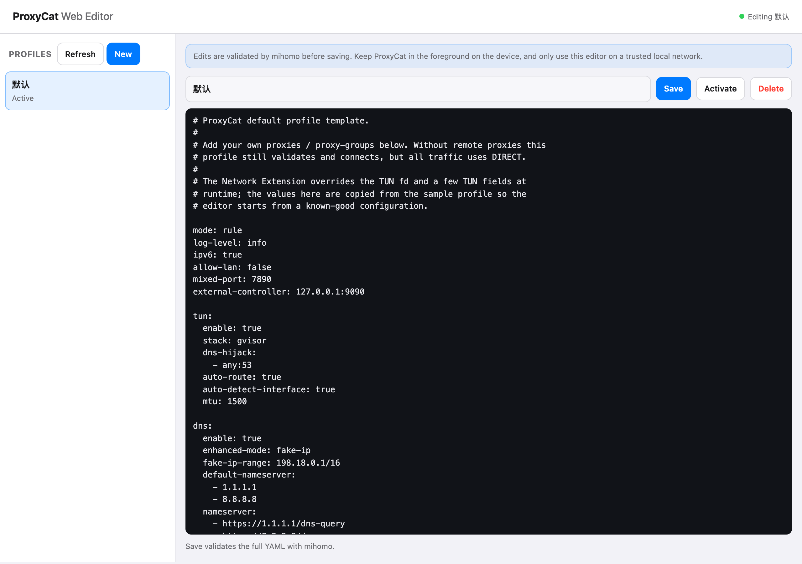
</p>

1. 打开 Settings → Web Editor，启用开关。
2. 默认端口 `8787`，可改为 `1024...65535` 之间的任意端口；修改会立即生效并重启服务。
3. 将手机和电脑连接到同一网络，在电脑浏览器中打开页面显示的地址；点 **Copy Link** 可复制带令牌的一键登录链接，或点 **Copy Token** 后在网页中输入令牌。页面上只显示不带令牌的地址，完整令牌不会直接展示在屏幕上。
4. 浏览器中可以切换 profile、激活、新建、删除，并编辑 YAML 后保存。

实现要点：

- 服务由宿主 App 的 `WebConfigServer` 提供，使用 Network.framework 监听 TCP；仅在 App 前台且开关开启时运行。运行期间会临时关闭系统自动锁屏，避免浏览器会话因休眠中断。
- 所有 `/api/*` 请求都需要 `Authorization: Bearer <token>`；令牌在每次 App 进程启动时随机生成，不写入磁盘，也不进入 iCloud 备份。
- 保存 / 新建都会先经过 mihomo 解析校验，再写入 `Profiles/`；成功后沿用正常的 `ProfileStore` 通知，让运行中的隧道 hot-reload。
- 页面资源位于 `BundledAssets/web-editor/`（`index.html` / `app.css` / `app.js`），由 Library.framework 直接读取。
- 服务启用时会通过 Bonjour（`_proxycat._tcp`）注册触发 iOS 局域网权限请求；首次使用请在弹窗中允许，或到 iOS 设置 → 隐私与安全性 → 本地网络 中开启 ProxyCat。
- 这是明文 HTTP 的局域网工具：只在可信 Wi-Fi 上开启，并妥善保管页面中的令牌。

## 代理组延迟测试

Proxies 标签页里组头部的秒表按钮调用 mihomo 的 `/group/{name}/delay` 端点。对 URLTest / Fallback 组而言，该端点**会先清空当前的手动选择再跑组内健康检查**（见 `mihomo/hub/route/groups.go` 中的 `ForceSet("")`），属于 mihomo 自身的行为：如果你在 URLTest / Fallback 组里钉了某个节点，再点这颗秒表会把钉子抹掉，组重新回到自动择优。Selector 组不受影响。要只刷新当前选择的延迟而不动钉子,请下拉页面或直接点中那个节点重新选定。

## 构建标识与诊断

`tools/proxycat_build/mihomo.py` 通过 `go build -ldflags -X` 注入构建期信息：

- `mihomo` 版本字符串（沿用 mihomo 自身 `Makefile` 的约定：tag 命中即 `v1.19.24`，Alpha/Beta 通道分别为 `alpha-<short>` / `beta-<short>`，否则回退 `git describe --tags --always`；不读取 `constant/version.go` 里上游从未维护的 `1.10.0` 占位符）
- mihomo 上游 commit 短哈希（来自 `git -C mihomo rev-parse`）
- xcframework 打包时间
- 启用的 build tags

Settings → Diagnostics 页面展示 `Libmihomo.Version()` 返回的 `VersionInfo`，方便附在 issue 报告中。

构建标签当前使用 `with_gvisor with_low_memory`：

- `with_gvisor`：保留 sing-tun 的 gVisor netstack（NE 必需）；
- `with_low_memory`：把 mihomo 每连接中继缓冲减半（TCP 32→16KB，UDP 16→8KB），并打开 `features.WithLowMemory`。100 个并发连接约可省 2.4MB。

构建器最后还会对 xcframework 各 slice 执行 `strip -x`，进一步压缩 NE 进程的二进制体积。

## 故障排查

| 现象 | 可能原因 |
|---|---|
| `No such module 'Libmihomo'` | 忘了跑 `python3 build.py libmihomo` |
| 连上 5 秒就掉线 | 触发 jetsam — 在 Console.app 检查是否有 `PcatExtension` 的 `EXC_RESOURCE` |
| `could not obtain TUN file descriptor` | 跨版本 iOS 的 KVC 路径变了 — 见 `TunnelFileDescriptor.locate(in:logger:)` |
| 连接成功但所有流量直连 / 全黑 | 检查 YAML 的 `external-controller` 是否可达，并查 Logs 标签页 |
| Dashboard 上 `Memory` 一直为 0 | 扩展尚未起来，`CommandClient` 还在重连退避中 |
